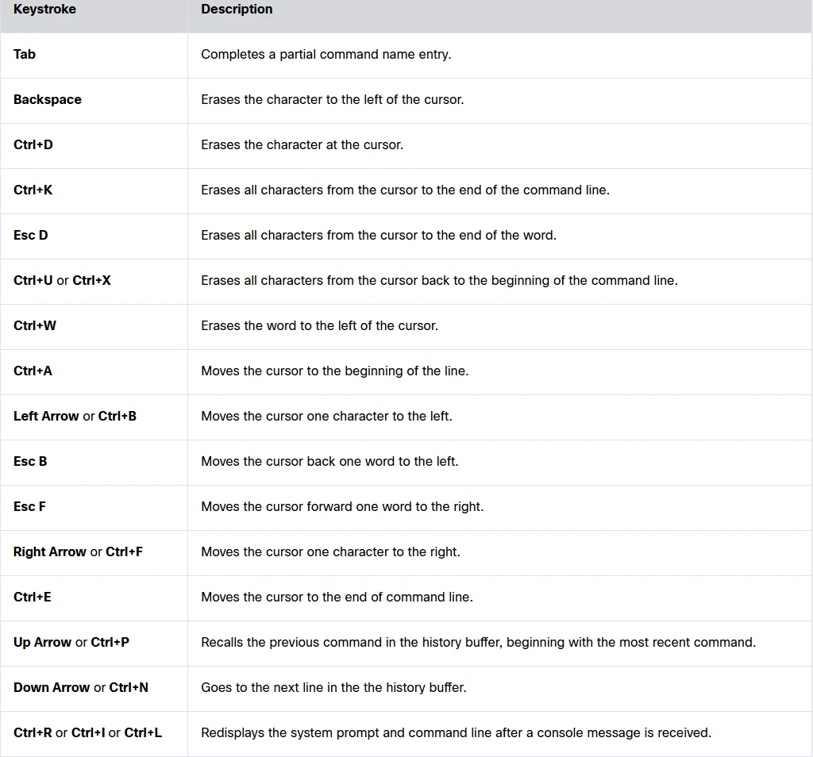

# Module 02 - Basic Switch and End Device Configuration Study Guide

[Class Documents](README.md) · [Startup](../Startup.md)

Cisco 1 · Fall 2 2026

Ingwell, Adam (ingwella@students.westerntc.edu)

Study guide (student) · November 4, 2026

**AI - Prohibited**

You may not submit AI-generated work as your own or use AI in ways that bypass the learning goals of the assignment. Prohibited uses include generating full or partial submissions, fabricating sources or data, completing assessments without permission, or failing to disclose AI use when disclosure is required. Such use may be treated as academic misconduct.

**AI policy accepted: AI - Prohibited, November 4, 2026 10:09 AM**

Statement accepted: By accepting, I agree to follow this lab’s AI usage policy. If I do not, this lab will not be counted toward my grade, and an academic integrity report will be made to the college and placed on my permanent record.

## Purpose

The purpose of this lab is to introduce you to fundamental switch and end device configuration, including the use of different access methods, securing devices with passwords, and understanding the basics of network connectivity and management.

## Knowledge

After completing this study guide, you will understand how to configure a basic switch, connect end devices, and secure a network using passwords and IP addressing.

## Tasks/Activities

> • A. Study Guide Questions
>
> • B. Reflection

## Criteria for Success

Success in this lab is marked by accurate task completion, effective analysis, documentation, and clear communication of findings. A crucial aspect involves reflecting on the purpose of the lab, linking procedures to broader concepts, and recognizing the lab's significance within the course.

Overall, success is not only measured by technical proficiency but also by critical thinking, effective communication, and a reflective summary that captures the challenges faced and insights gained throughout the lab experience.

## A. Study Guide Questions

> This guide should be completed by you as you go through the reading of module 2 in the Cisco NetAcad. This will not need to be turned in, but you will be quized on the topics covered here.

While reading the module, complete the study guide. At the end, reflect on the topics from the module.

### A.1 Please explain the 3 different access methods you can use to connect to a switch's operating system.

**Your answer**

**Console - A physical management port to connect directly to the switch.**  
**Secure Shell - A secure connection to remotely establish a CLI connection, requires active network.**  
**Telnet - Unsecure remote connection to a CLI, requires active network, will broadcast usernames, passwords, etc in plain text.**

### A.2 What's the difference between telnet and SSH? Which one would you choose to use and why?

**Your answer**

**SSH is secure and encrypted where Telnet is not even remotely secure and will broadcast user info in plain text that anyone that is connected can see.**

### A.3 Explain the 2 primary modes of operation in a networking device.

**Your answer**

**User exec mode - a view only mode that does not allow you to change the configuration of a device.**  
**Privileged exec mode - a more powerful mode that allows you to view and change all files.**

### A.4 Explain what Global Configuration Mode is.

**Your answer**

**Global configuration mode allows you to change any configuration on a router, including usernames, passwords, etc.**

### A.5 When using a networking device's CLI, why is the "?" one of the most valuable keys on the keyboard?

**Your answer**

**? will help you understand context-sensitive commands such as which commands are available, which commands start with specific characters, or which arguments and keywords are available.**

### A.6 What Hot Keys and Shortcuts are available to you in a networking device's CLI?

**Your answer**

**I provided a screenshot of the hotkeys.**  
**There is also enter to display the next line, space bar to display the next screen, any other key will return to the previous prompt.**  
**Ctrl-C will return to privileged exec mode or aborts to the command prompt if you are in setup.**  
**Ctrl-Z will return to privileged exec mode.**  
**Ctrl-shift-6 will abort DNS lookups, traceroutes, pings, etc.**

### A.7 Explain some guidelines to keep in mind when it comes to naming your networking devices.

**Your answer**

**Names should start with a letter, contain no spaces, end with a letter or number, use only letters, numbers or dashes, and be less than 64 characters in length.**

### A.8 In order to keep our devices secure we will be using passwords. What can we do to make our passwords as secure as possible?

**Your answer**

**Use passwords that are more than eight characters in length, use upper and lowercase letters, numbers, special characters, or numeric sequences, avoid using the same password for all devices, and do not use common words that are easily guessed.**

### A.9 What is the difference between a Privileged EXEC Password and a User Exec Password?

**Your answer**

**A user exec password will be entered by using the password command and the privileged exec password will be used by entering the enable secret (password) command.**

### A.10 What are a networking device's two main configuration files, and where are they stored?

**Your answer**

**Startup-config contains all commands that will be used by startup or reboot and is stored in NVRAM**  
**Running-config reflects the current configuration and is stored in RAM. It will lose all content once the device is powered down or restarted.**

### A.11 Why does a device on a network need an IP Address?

**Your answer**

**An IP address is basically the name that your device uses to communicate with other devices. It cannot communicate without one.**

### A.12 How many IP Addresses can one device have at the same time?

**Your answer**

**A device can have one IP address per network interface. For example Wi-Fi and Ethernet can have different IP addresses.**

### A.13 What command allows you to verify a computer's IP Configurations on a Windows PC?

**Your answer**

**ipconfig**

### A.14 What is the name of the interface on a switch that gets an IP Address? Also, how do you put an IP Address on that interface?

**Your answer**

**The switch virtual interface or SVI get an IP address.**  
**configure terminal**  
**interface vlan 1**  
**ip address (enter address here)**  
**no shutdown**  
**end**  
**copy running-config startup-config**

### A.15 Why would you test End-to-End Connectivity and what command would you use to test it?

**Your answer**

**You would test end-to-end connectivity to verify that you are connected to the network. You would use the command ping (enter ip address)**

## B. Refelction

### B.1 What is one thing that you learned from module 2?

**Your answer**

**I learned the difference between console, ssh, and telnet and why you should only use telnet in a lab environment.**

### B.2 What do you think the most important thing from this module was?

**Your answer**

**I think properly making a password is the most important thing from this module.**
