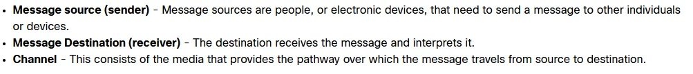
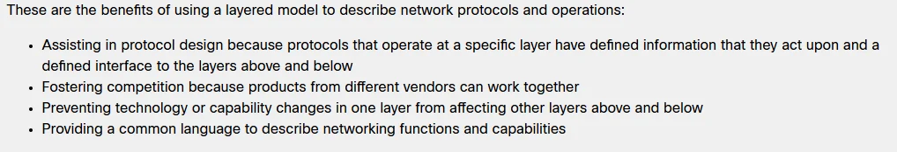
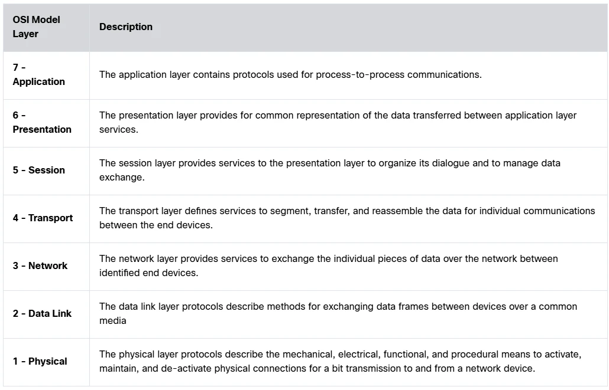
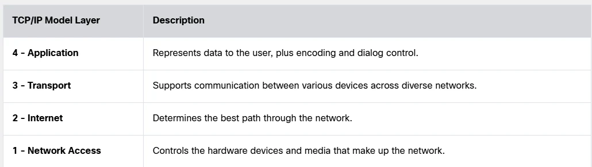
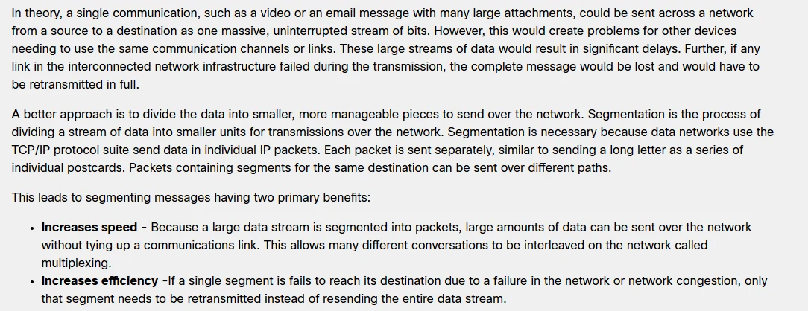

# Module 03 - Protocols and Models Study Guide

[Class Documents](README.md) · [Module 3 notes](../Module-3.md) · [Startup](../Startup.md)

Cisco 1 · Fall 2 2026

Ingwell, Adam (ingwella@students.westerntc.edu)

Study guide (student) · November 6, 2026

**AI - Prohibited**

You may not submit AI-generated work as your own or use AI in ways that bypass the learning goals of the assignment. Prohibited uses include generating full or partial submissions, fabricating sources or data, completing assessments without permission, or failing to disclose AI use when disclosure is required. Such use may be treated as academic misconduct.

**AI policy accepted: AI - Prohibited, November 6, 2026 11:19 AM**

Statement accepted: By accepting, I agree to follow this lab’s AI usage policy. If I do not, this lab will not be counted toward my grade, and an academic integrity report will be made to the college and placed on my permanent record.

## Purpose

The purpose of this study guide is to deepen your understanding of networking protocols and models, specifically the OSI and TCP/IP models, and their role in facilitating reliable and efficient communication across networks.

## Knowledge

After completing this study guide, you will understand how various network models, protocols, and standards enable effective communication and data transfer in both local and remote networks.

## Tasks/Activities

> • A. Study Guide Questions
>
> • B. Reflection

## Criteria for Success

Success in this lab is marked by accurate task completion, effective analysis, documentation, and clear communication of findings. A crucial aspect involves reflecting on the purpose of the lab, linking procedures to broader concepts, and recognizing the lab's significance within the course.

Overall, success is not only measured by technical proficiency but also by critical thinking, effective communication, and a reflective summary that captures the challenges faced and insights gained throughout the lab experience.

## A. Study Guide Questions

> This guide should be completed by you as you go through the reading of module 3 in the Cisco NetAcad. This will not need to be turned in, but you will be quized on the topics covered here.

While reading the module, complete the study guide. At the end, reflect on the topics from the module.

### A.1 What needs to happen before successful communication can occur?

**Your answer**

**Devices need to know how to communicate.**

### A.2 What does it mean to encode a message?

**Your answer**

**Encoding is converting information into another acceptable form for communication.**  
**It is like converting thoughts into language so you can communicate your thoughts to a friend.**

### A.3 What is message formatting and encapsulation?

**Your answer**

**The format is the type of information that you are trying to send, like a letter.**  
**Encapsulation is putting one format into another format, like putting said letter into an envelope.**

### A.4 Please explain the difference between Unicast, Multicast & Broadcast.

**Your answer**

**Unicast is sending a message to a single device.**  
**Multicast is sending a message to one or more end devices.**  
**Broadcast is sending a message to all end devices.**

### A.5 Why are open standards so important?

**Your answer**

**Open standards make sure that all devices can understand each other, it gives the user a choice between devices that they buy, and it keeps one company from having a monopoly.**

### A.6 How is an open standard different from a proprietary standard?

**Your answer**

**An open standard lets all devices use it without having any dedicated equipment.**  
**A proprietary standard is controlled by a company that decides how it changes and controls who can implement it.**

### A.7 What are the benefits to using a layered model to describe network protocols and operations?

**Your answer**

### A.8 List and describe the 7 layers of the OSI Model:

**Your answer**

### A.9 List and describe the 4 layers of the TCP/IP Model:

**Your answer**

### A.10 What are the two primary benefits of segmenting messages?

**Your answer**

### A.11 As a PDU is encapsulated please provide the name according to each layer of the TCP/IP Stack.

**Your answer**

**TCP/IP layer PDU name**  
**Application Data**  
**Transport Segment (TCP) or datagram (UDP)**  
**Internet Packet**  
**Network Access Frame**  
  
  
**As the data moves down the stack, each layer wraps it with its own control information. The Network Access layer then transmits the frame as bits. If your class shows a separate Physical layer, bits go there.**

### A.12 As a PDU travels from the original source to the final destination, which address never changes?

**Your answer**

**The source and destination IP addresses stay the same from the original sender to the final receiver during normal routing. The source and destination MAC addresses change at each router hop because the router builds a new frame for the next link.**  
  
**If a router uses NAT, it can change an IP address.**

### A.13 Explain the difference between how devices on the same network communicate compared to devices on a remote network.

**Your answer**

**Destination How the device sends the data**  
**Same network: It sends the frame directly to the destination device's MAC address, typically through a switch.**  
**Remote network: It sends the frame to the default gateway's MAC address. The gateway is a router that forwards the packet toward the remote network.**  
  
  
**For IPv4, the sending device uses ARP to learn the MAC address it needs. In both cases, the packet's destination IP address is the final device's IP address. The frame's destination MAC address identifies who receives it on the local link.**

### A.14 The term "Default Gateway" is used a few times towards the end of this module. Based on your understanding, please explain what a default gateway is and why it's so important.

**Your answer**

**A default gateway is the router address a device uses to send data outside its local network. For example, your computer can talk directly to a printer on the same network, but when you open a website, it sends the traffic to the default gateway. The router then forwards it toward the website.**  
  
**The default gateway is important because without a working one, your device can usually still communicate with local devices, but it typically can't reach the internet or other remote networks.**

## B. Reflection

### B.1 What is one thing that you learned from module 3?

**Your answer**

**I learned the actual terminology for how data is transmitted between devices.**

### B.2 What do you think the most important thing from this module was?

**Your answer**

**The importance of open standards.**
