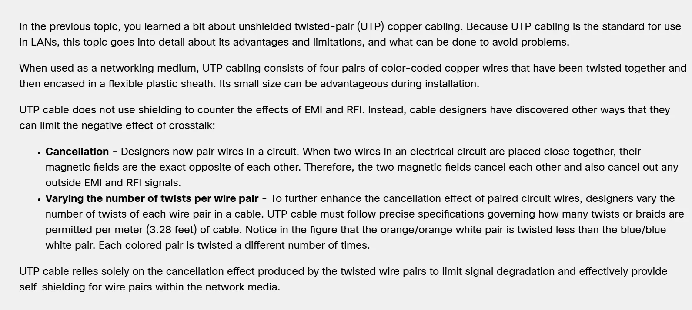
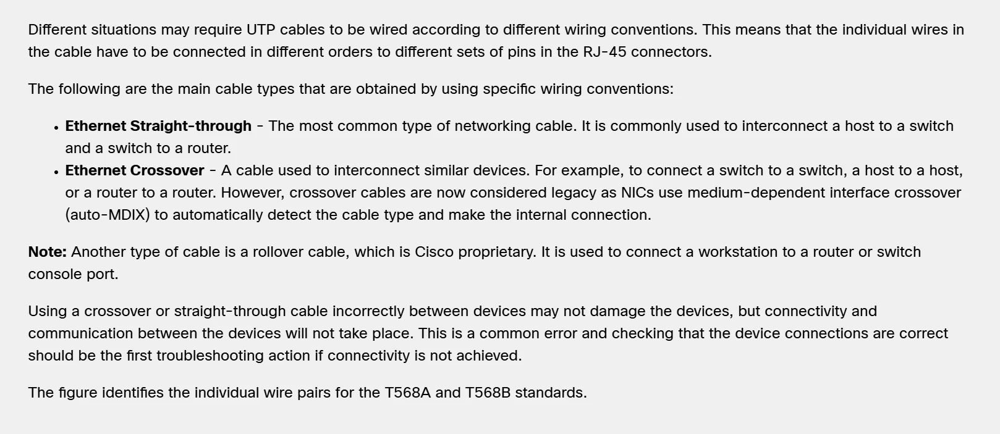
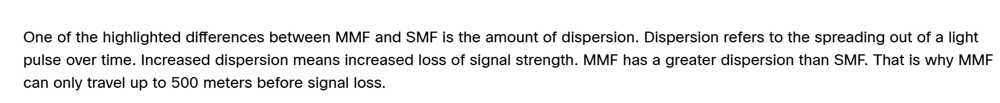
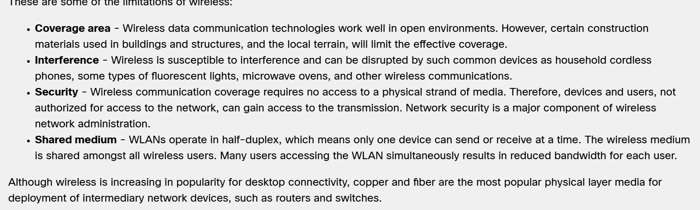

# Module 4 Physical Layer Study Guide

[Back to Module 4](../Module-4.md) · [Class Documents](README.md)

Cisco 1 · Fall 2 2026

Study guide (student) · November 9, 2026

## AI - Prohibited

You may not submit AI-generated work as your own or use AI in ways that bypass the learning goals of the assignment. Prohibited uses include generating full or partial submissions, fabricating sources or data, completing assessments without permission, or failing to disclose AI use when disclosure is required. Such use may be treated as academic misconduct.

AI policy accepted: AI - Prohibited, November 9, 2026 11:27 AM

Statement accepted: By accepting, I agree to follow this lab’s AI usage policy. If I do not, this lab will not be counted toward my grade, and an academic integrity report will be made to the college and placed on my permanent record.

## Purpose

The purpose of this study guide is to deepen your understanding of the physical layer in networking, including the various signaling methods, network media types, and factors affecting network performance such as bandwidth, throughput, and interference.

## Knowledge

After completing this study guide, you will understand the different network media types, their characteristics, and how they impact overall network performance and efficiency.

## Tasks/Activities

- A. Study Guide Questions

- B. Reflection

## Criteria for Success

Success in this lab is marked by accurate task completion, effective analysis, documentation, and clear communication of findings. A crucial aspect involves reflecting on the purpose of the lab, linking procedures to broader concepts, and recognizing the lab's significance within the course.

Overall, success is not only measured by technical proficiency but also by critical thinking, effective communication, and a reflective summary that captures the challenges faced and insights gained throughout the lab experience.

## A. Study Guide Questions

This guide should be completed by you as you go through the reading of module 4 in the Cisco NetAcad. This will not need to be turned in, but you will be quized on the topics covered here.

While reading the module, complete the study guide. At the end, reflect on the topics from the module.

### A.1 What are the 3 signaling methods for the 3 unique network media?

**Your answer**

electrical, optical, and wireless

### A.2 Explain bandwidth, throughput, latency and goodput.

**Your answer**

Bandwidth is the capacity of which a medium can carry data.

Latency is the amount of time it takes for information to get from one point to another.

Throughput is basically how fast you are transmitting data. It will be lower than your bandwidth because of traffic and network latency.

Goodput is the measure of usable data transferred over a given amount of time. It's basically your average speed.

### A.3 What is EMI, RFI & Crosstalk?

**Your answer**

EMI is electromagnetic interference.

RFI is radio frequency interference .

Crosstalk is when you pick up data from another signal. Like when you pick up somebody else's conversation on the phone.

### A.4 Explain what makes UTP different from STP.

**Your answer**

UTD is unshielded cable where STP is shielded cable. Shielded cable helps lessen interference from outside sources.

### A.5 How does UTP limit the negative effects of crosstalk?

**Your answer**

### A.6 Explain the difference between a properly terminated UTP cable and a poorly terminated UTP cable.

**Your answer**

A properly terminated cable will have the outer layer inside of the connector with no wires showing outside.

### A.7 Explain the difference between a straight-through and crossover cable. Also, when do you each respective cable?

**Your answer**

### A.8 What's the difference between Single-Mode Fiber and Multimode Fiber?

**Your answer**

(No answer provided)

### A.9 When would you use Fiber versus Copper cables?

**Your answer**

### A.10 Explain the limitations of wireless.

**Your answer**

## B. Reflection

### B.1 What is one thing that you learned from module 4?

**Your answer**

The different types of fiber optics.

### B.2 What do you think the most important thing from this module was?

**Your answer**

The advantages and limitations of the different types of physical media.
