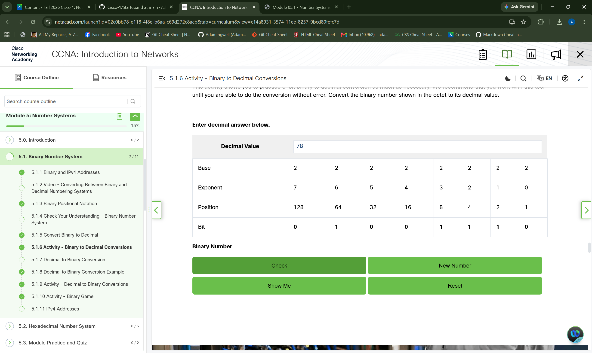
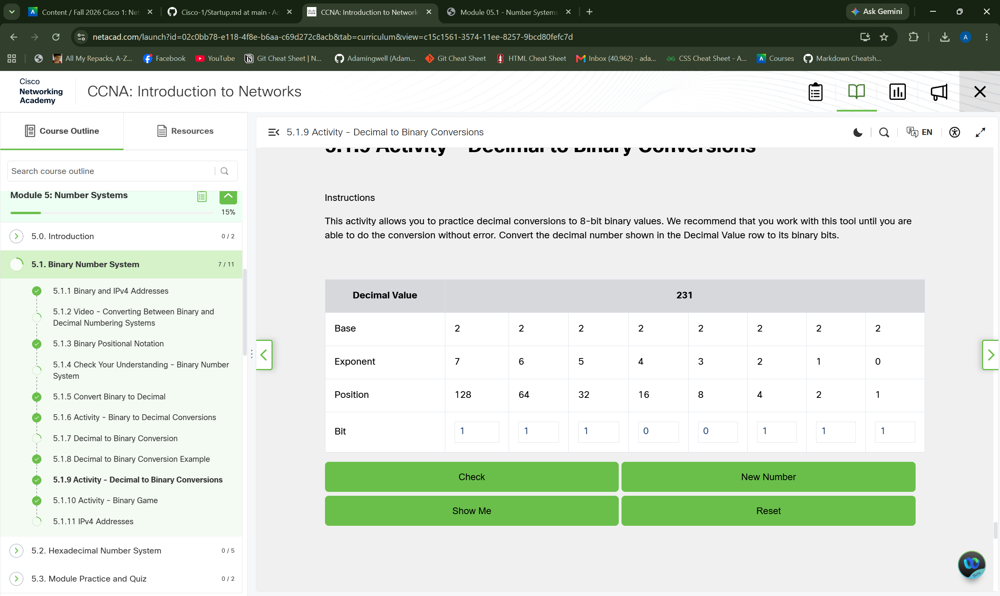
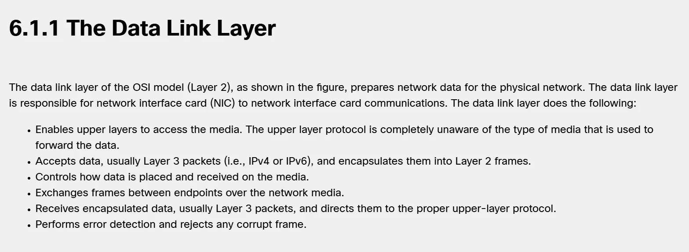
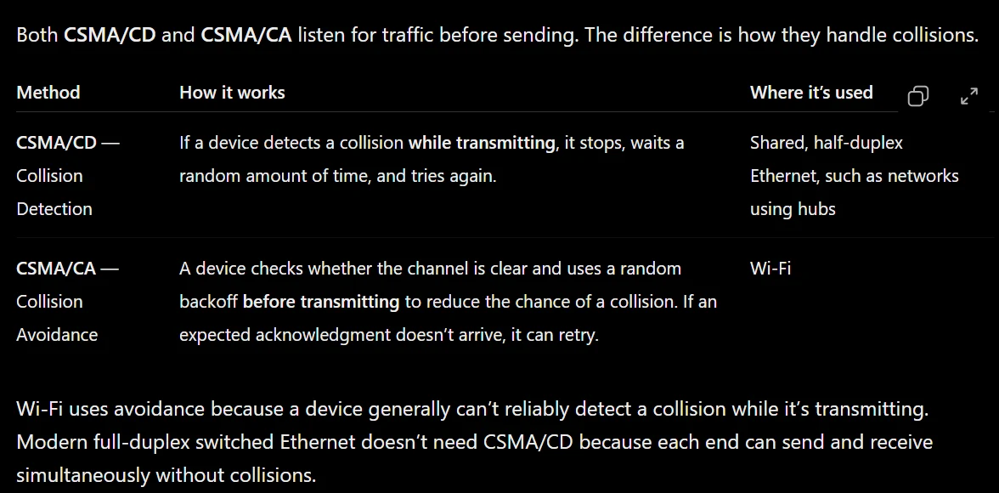
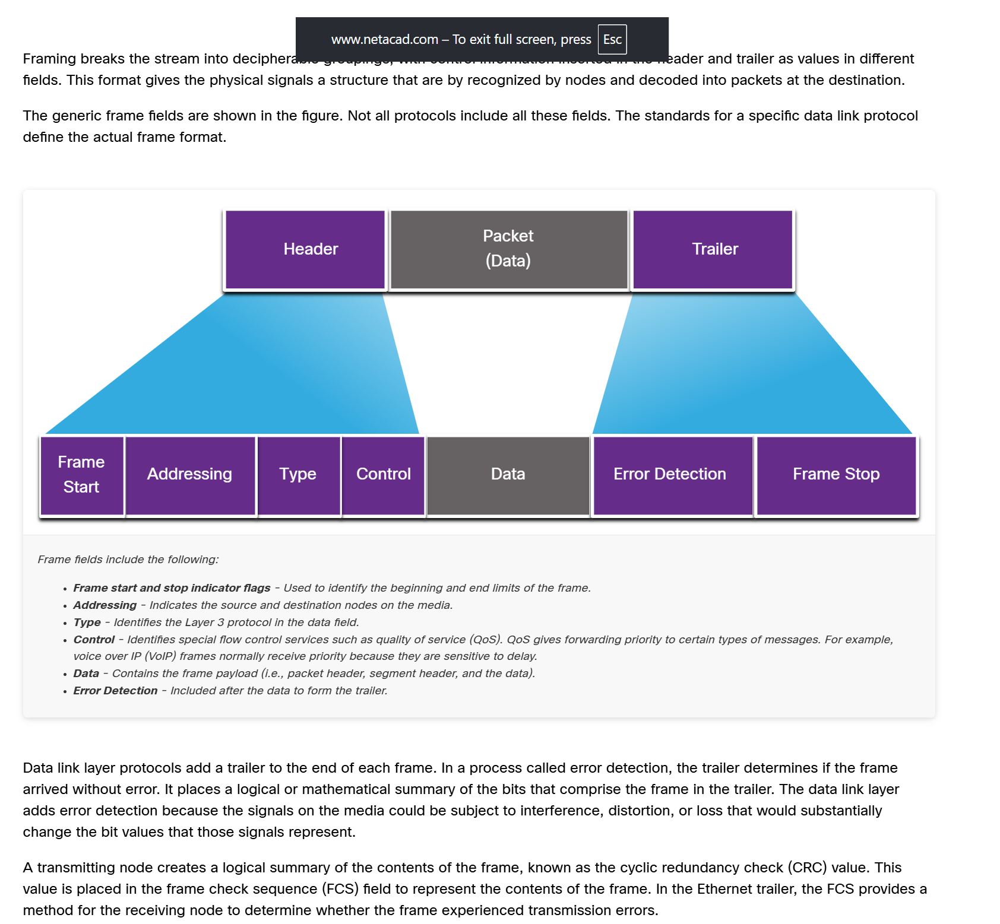

# Modules 5.1 and 6 Study Guide

[Class documents](README.md) · [Module notes](../Modules-5-1-and-6.md)

Cisco 1 · Fall 2 2026

Adam Ingwell

Study guide (student) · November 9, 2026

**AI - Prohibited**

You may not submit AI-generated work as your own or use AI in ways that bypass the learning goals of the assignment. Prohibited uses include generating full or partial submissions, fabricating sources or data, completing assessments without permission, or failing to disclose AI use when disclosure is required. Such use may be treated as academic misconduct.

**AI policy accepted: AI - Prohibited, November 9, 2026 12:08 PM**

Statement accepted: By accepting, I agree to follow this lab’s AI usage policy. If I do not, this lab will not be counted toward my grade, and an academic integrity report will be made to the college and placed on my permanent record.

**Purpose**

The purpose of this study guide is to deepen your understanding of the binary number system and key data link layer concepts, including WAN topologies, duplex modes, and error detection techniques, through hands-on activities and critical reflection.

**Knowledge**

After completing this study guide, you will have a thorough understanding of the binary number system and how the data link layer manages communication, error detection, and network topology in networking systems.

**Tasks/Activities**

> • A. Study Guide Questions
>
> • B. Reflection

**Criteria for Success**

Success in this lab is marked by accurate task completion, effective analysis, documentation, and clear communication of findings. A crucial aspect involves reflecting on the purpose of the lab, linking procedures to broader concepts, and recognizing the lab's significance within the course.

Overall, success is not only measured by technical proficiency but also by critical thinking, effective communication, and a reflective summary that captures the challenges faced and insights gained throughout the lab experience.

## A. Study Guide Questions

> This guide should be completed by you as you go through the reading of module 5.1 and module 6 in the Cisco NetAcad. This will not need to be turned in, but you will be quized on the topics covered here.

While reading the module, complete the study guide. At the end, reflect on the topics from the module.

> 1\. Please review all of Chapter 5.1 information about the binary number system. We will be reviewing this information at the beginning of class. Activities 5.1.6 & 5.1.9 are great practice. Provide a screenshot of one successful completion of 5.1.6 and 5.1.9:

**A.5.1.6**

**Your answer**

**A.5.1.9**

**Your answer**

**A.2 Does the network layer know about what physical media the packet will be travelling on? Why?**

**Your answer**

**No. The network layer (Layer 3) uses the destination IP address to determine where to send the packet next. The data link layer (Layer 2) puts the packet into a frame for that link, and the physical layer (Layer 1) sends the bits as electrical, optical, or radio signals.**  
  
**This separation lets the same IP packet travel over Wi-Fi on one link and fiber on another. Each link handles its own physical medium.**

**A.3 Explain the difference between the 3 different WAN Topologies.**

**Your answer**

**Point to point - a permanent link between two endpoints such as a link between two computers.**  
**Hub and spoke - endpoints being joined together through a central hub.\]**  
**Every endpoint is interconnected on the system.**

**A.4 Explain the difference between full & half duplex.**

**Your answer**

**Half duplex - systems can communicate with each other but only one at a time.**  
**Full duplex - all systems can communicate at the same time.**

**A.5 Explain the difference between CSMA/CD and CSMA/CA?**

**Your answer**

**A.6 Which network media is used by CSMA/CD & CSMA/CA?**

**Your answer**

**CD is wired, CD is wireless**

**A.7 List and define the Ethernet Frame Fields:**

**Your answer**

**A.8 Explain how the Data Link Layer handles Error Detection.**

**Your answer**

**The Data Link Layer checks whether a frame was corrupted while traveling across a network link. In Ethernet, it uses a Cyclic Redundancy Check (CRC) to do this.**  
**1. The sender calculates a CRC value from the frame's contents and puts it in the Frame Check Sequence (FCS) field at the end of the frame.**  
**2. The receiver calculates its own CRC value from the received contents and compares it with the value in the FCS.**  
**3. If the values match, the frame passes the error check. If they differ, the receiver discards the frame.**  
**Ethernet's CRC detects errors. If lost data needs to be resent, a higher-layer protocol such as TCP can handle retransmission.**

**A.9 Review 6.3.3 and think about which type of address holds "global significance" and which type of address holds "local significance." Also, what does that mean?**

**Your answer**

**IP address holds global significance and MAC address holds global significance. IP is on a WAN and MAC is on a LAN.**

## B. Reflection

**B.1 What is one thing that you learned from module 5.1 and 6?**

**Your answer**

**How to compute binary.**

**B.2 What do you think is the most important thing from these modules was?**

**Your answer**

**Why MAC is local and IP is global.**
