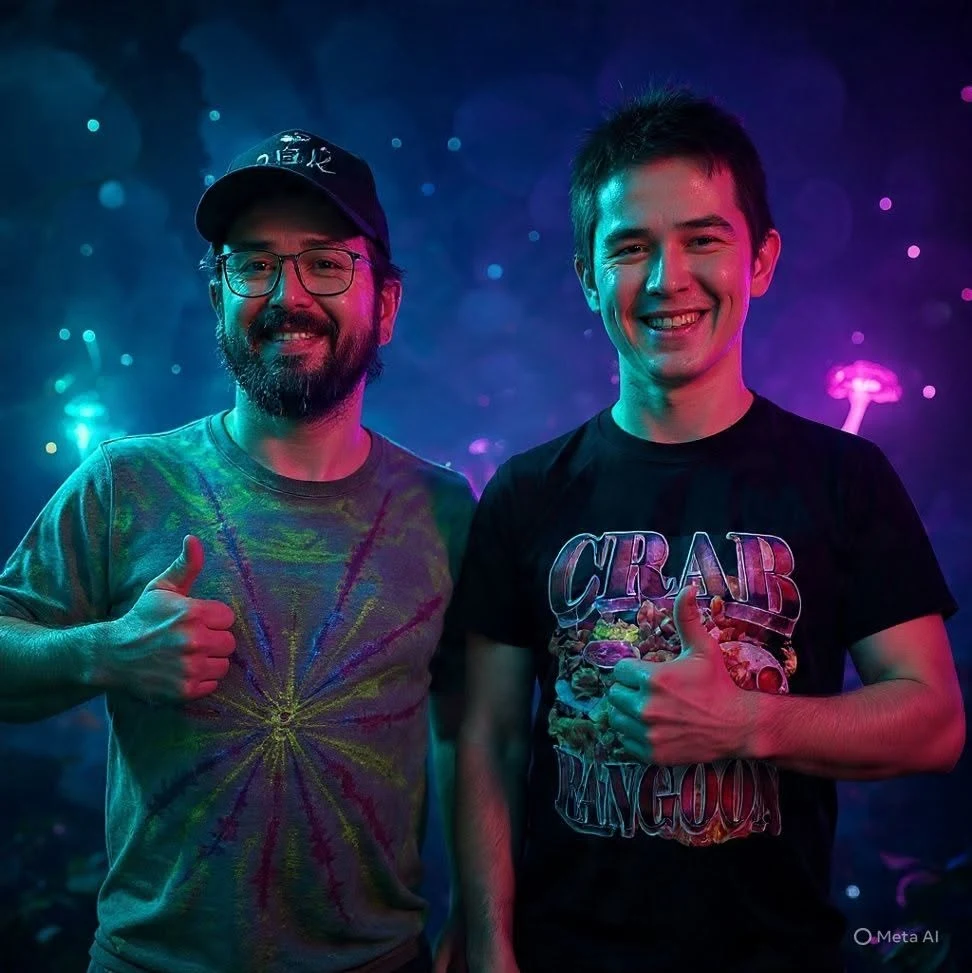

# Personal Bio

[Class Documents](README.md) · [Startup](../Startup.md)

Student: Ingwell, Adam (ingwella@students.westerntc.edu)

Class: Cisco 1

Exported: November 2, 2026 11:44 AM

**AI - Limited**

You may use AI tools for this assignment only as a support for planning, feedback, revision, or analysis. If you use AI, you must disclose how you used it, include relevant prompts or outputs when requested, and explain how you evaluated or revised the AI’s contribution.

Allowed for this lab: Spelling/grammar checks.

**AI policy accepted: AI - Limited, November 2, 2026 11:31 AM**

Statement accepted: By accepting, I agree to follow this lab’s AI usage policy. If I do not, this lab will not be counted toward my grade, and an academic integrity report will be made to the college and placed on my permanent record.

### 1.a. Who are you?

**I'm Adam, I'm 40 years old, and a father of two boys. I recently decided that factory and foodservice work is not for me anymore. This decision made me come back to school, get a degree, and do something more with my life.**

### 1.b. What brings you to Western?

**Western is a great place to start my new journey. I didn't want to go to a university right away. Western is close, has smaller classes, is affordable, and had the exact education path for the career that I would like to pursue.**

### 1.c. Why did you choose your current program?

**I've always been interested in how things work. I enjoy building things and enjoy seeing the end result of my work.**

### 1.d. What do you do for fun?

**I like to go to concerts or comedy shows.**

### 1.e. If you would like to share more than that feel free to include information about your family, pets, hobbies, or other interests.

**(No answer provided)**

### 1.f. Please attach an image of yourself.

## AI usage disclosure

Explain how you used AI in this lab: which tool(s), what you asked, and how you used the results.

**The only AI used was in my picture.**
