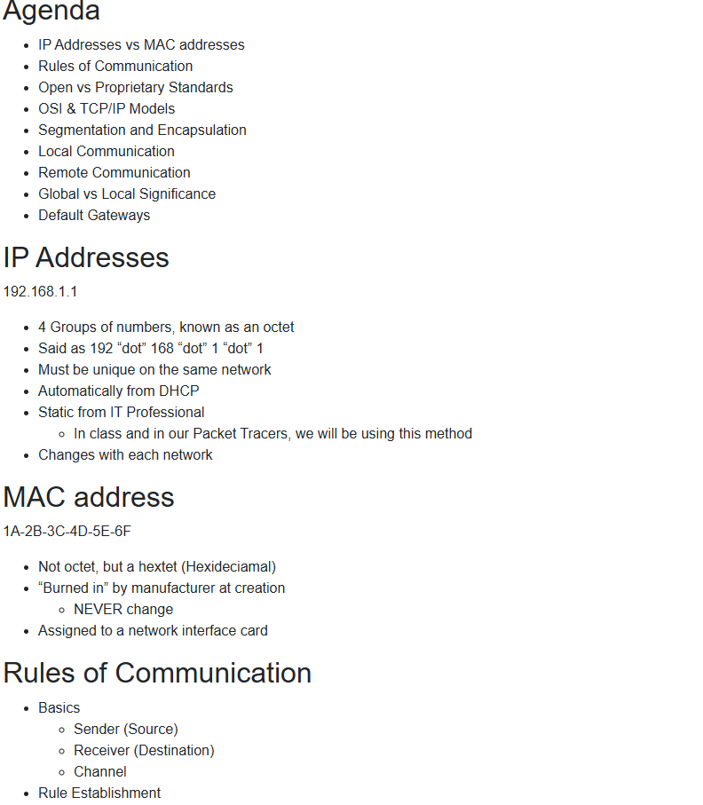
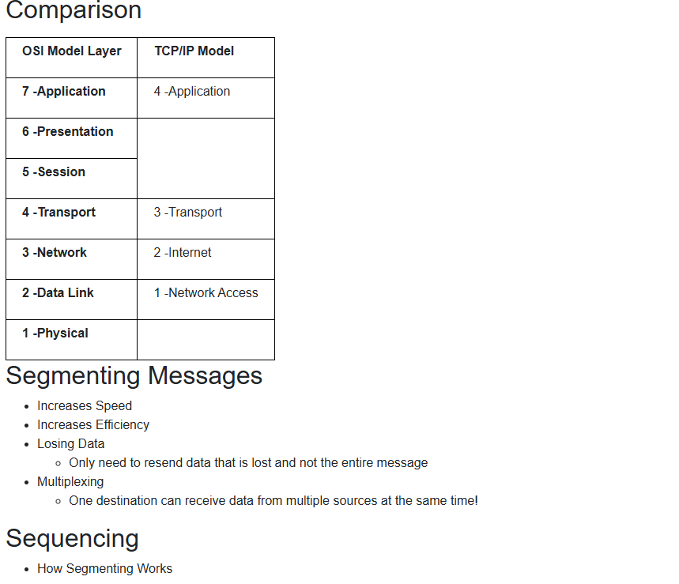
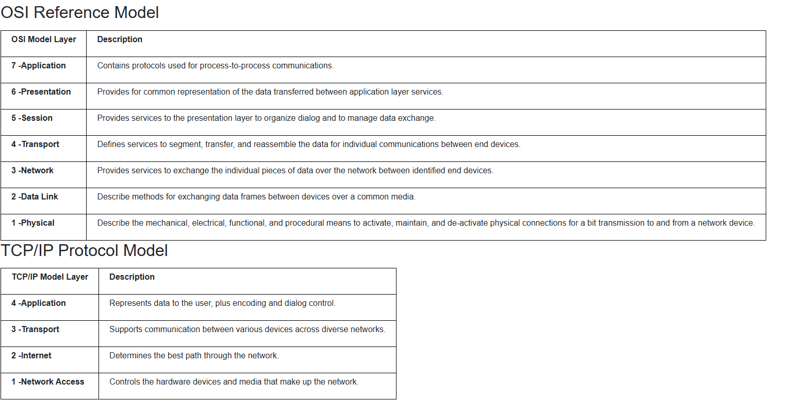
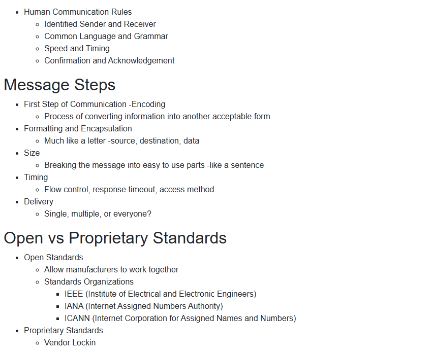
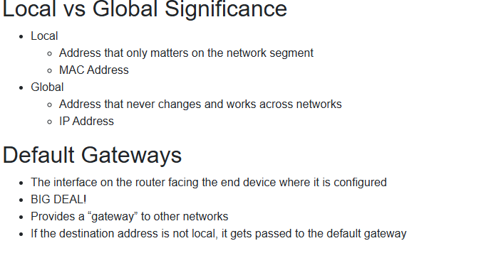

# Module 3: Network Models and Rules

[All modules](Cisco-1-Notes.md) · [Module 1](Module-1.md) · [Module 2](Module-2.md) · [Module 3](Module-3.md)

[Configure IP addresses and test connectivity](Packet-Tracer/Configure-IP-Addresses-and-Test-Connectivity.md) · [Slides](#presentation-slides)

### Module 3 Visuals

### Presentation Slides

Show slides

[Back to all modules](Cisco-1-Notes.md)
