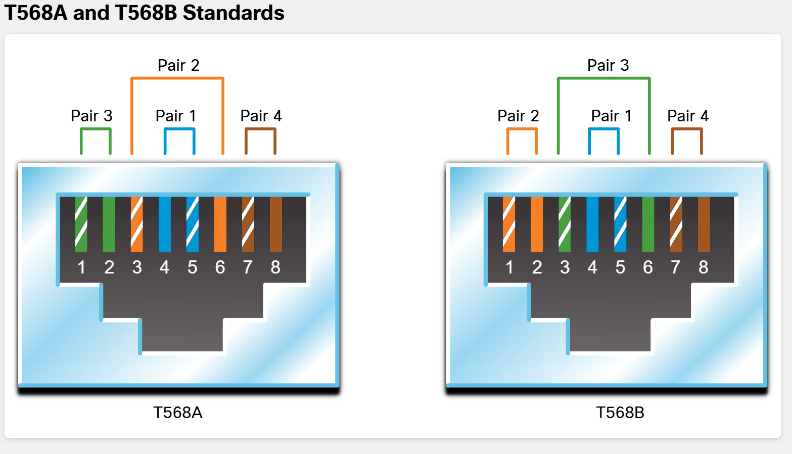

# RJ-45 Cabling: T568A and T568B

[Back to Module 4](Module-4.md#ethernet-cabling)

The **green and orange pairs swap positions** between T568A and T568B. The **blue pair stays on pins 4 and 5**, and the **brown pair stays on pins 7 and 8**.

| Pin | T568A | T568B |
| --- | --- | --- |
| 1 | White/green | White/orange |
| 2 | Green | Orange |
| 3 | White/orange | White/green |
| 4 | Blue | Blue |
| 5 | White/blue | White/blue |
| 6 | Orange | Green |
| 7 | White/brown | White/brown |
| 8 | Brown | Brown |
